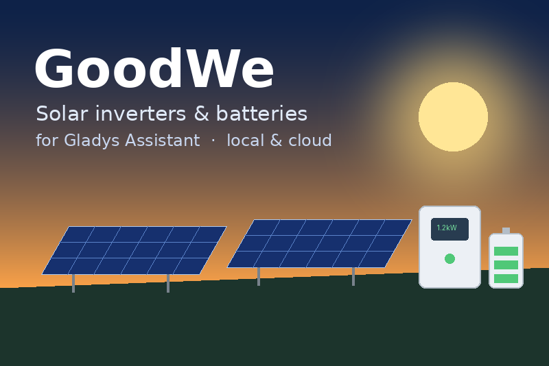

# GoodWe for Gladys Assistant

External integration for [Gladys Assistant](https://gladysassistant.com) that
brings **GoodWe** solar inverters and batteries into Gladys: production, house
consumption, grid import/export and battery, **locally** (UDP, no account) or
through the **SEMS cloud**, with scene triggers, scene actions and dashboard
widgets.



User documentation: [English](docs/en.md) · [Français](docs/fr.md) ·
[Deutsch](docs/de.md) · [Español](docs/es.md).

## Features

- **Local and cloud** (`transports: ["local", "cloud"]`): one Gladys device per
  inverter, keyed by its serial number. Read on the LAN every minute; falls
  back to the SEMS+ portal when the LAN fails (degraded badge), and back. The
  standard "Prefer the local connection" toggle picks the first channel.
- **Discovery** through the Gladys core (`network_discovery`
  `udp-active-broadcast` on port 48899: the container cannot broadcast on the
  LAN itself), plus manual IP addresses, plus the inverters of the SEMS
  account.
- **Three families**, ported from the reference
  [`goodwe`](https://github.com/marcelblijleven/goodwe) library and tested on
  frames captured on real units:
  - ET / EH / BT / BH / GEH hybrids (Modbus over UDP, address 0xF7);
  - DT / MS / D-NS / XS / GEP grid-tied (Modbus over UDP, address 0x7F);
  - ES / EM / BP hybrids (AA55 protocol).
- **Features**: solar production, daily and total production, signed grid
  power, grid import/export indexes, house consumption, battery level,
  charge/discharge power and energy, inverter temperature, grid voltage — only
  those the inverter actually reports.
- **Scene triggers**: production started/stopped, solar surplus started/ended
  (configurable threshold), inverter fault, inverter unreachable/back online.
- **Scene actions**: read the inverter (values as outputs), set the operation
  mode, limit the grid export, set the battery depth of discharge.
- **Widgets**: live overview of one inverter, production/consumption chart with
  the energy balance of the day.
- **Four languages** for every user-facing text: English, French, German,
  Spanish.

## Project structure

```
index.js                     SDK bootstrap (handlers registered by src/app.js)
src/app.js                   SDK wiring: discovery, poll, actions, scenes, widgets
src/service.js               inventory, local/cloud routing, transports, events
src/goodwe/protocol.js       Modbus-over-UDP and AA55 frames, CRC, readers
src/goodwe/udpClient.js      UDP request/response with retries, one request per host
src/goodwe/inverter.js       identification, live values, settings (ET/DT/ES)
src/goodwe/models.js         family and phases from the serial number
src/sems/client.js           SEMS+ cloud client (read-only)
src/devices/inverter.js      Gladys device and features of an inverter
src/events.js                scene trigger transitions
src/scenes.js                scene action handlers
src/widgets.js               dashboard widgets
src/i18n.js                  user-facing texts (en, fr, de, es)
src/config.js                configuration defaults and normalization
docs/                        user documentation (en, fr, de, es)
test/                        node --test, with a fake inverter (real UDP) and a fake SEMS
```

## Development

```bash
npm install
npm test               # node --test (fake inverter on 127.0.0.1, fake SEMS: no network)
npm run lint           # ESLint
npm run format:check   # Prettier
npx github:GladysAssistant/integration-store .   # store admission checks
```

Run against a real Gladys:

```bash
GLADYS_HOST_API_URL="http://localhost:1443" \
GLADYS_INTEGRATION_TOKEN="<token>" \
GLADYS_INTEGRATION_SELECTOR="goodwe" \
LOG_LEVEL=debug \
npm start
```

See [`CLAUDE.md`](CLAUDE.md) for the project rules (external ids, changelog,
releases, translations).

## Release

Describe the changes under `## [Unreleased]` in [`CHANGELOG.md`](CHANGELOG.md),
then **Actions → Release → Run workflow** (patch, minor or major): the workflow
bumps `package.json` and the manifest, rolls the changelog, tags, builds the
`linux/amd64` + `linux/arm64` image to `ghcr.io` and publishes the GitHub
Release. The GitHub topic `gladys-assistant-integration` makes the store index
it.

## Credits and licence

Protocol knowledge from the [`goodwe`](https://github.com/marcelblijleven/goodwe)
library (MIT) and the SEMS+ API notes of
[goodwe-sems-home-assistant](https://github.com/TimSoethout/goodwe-sems-home-assistant).
Built from the official
[integration template](https://github.com/GladysAssistant/integration-template-js).

GoodWe is a trademark of GoodWe Technologies Co., Ltd. This community
integration is not affiliated with or endorsed by GoodWe.

Apache-2.0
